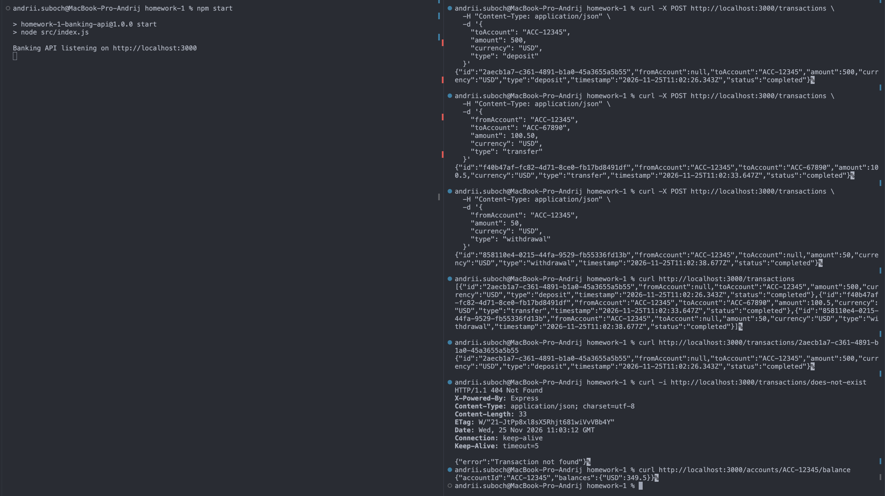
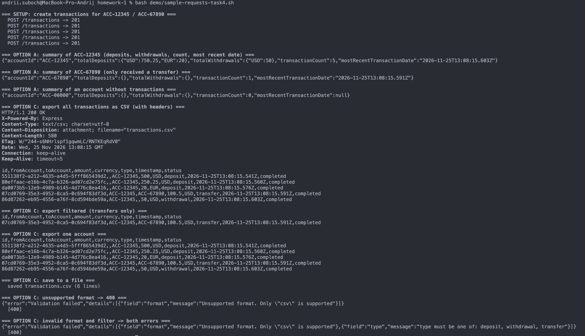

# 🏦 Homework 1: Banking Transactions API

> **Student Name**: Andrii Suboch
> **Date Submitted**: 25.11.2026
> **AI Tools Used**: Claude Code (Claude Opus 5.5 / Sonnet 5.5)

A REST API for banking transactions built with **Node.js + Express**, with in-memory storage (data is lost on restart).

✅ **Done:** Task 1 (core API) · Task 2 (validation) · Task 3 (history filters) · Task 4 (**both** Option A summary and Option C CSV export) · plus my own rule — **a balance can never go negative** (overdrafts become `failed` transactions) — and **56 automated tests**.

## 🚀 Quick Start

```bash
cd homework-1
npm install
./demo/run.sh --sample-data      # starts on http://localhost:3000 with 16 example transactions (or: npm start)
npm test                         # 56 tests, runs on a random port
```

Needs Node.js 18+. Full guide, configuration and troubleshooting: **[HOWTORUN.md](HOWTORUN.md)**.

## 📡 Endpoints

| Method | Endpoint | Description | Status |
|--------|----------|-------------|--------|
| `POST` | `/transactions` | Create a transaction (an overdraft is stored as `failed`, still `201`) | 201, 400 |
| `GET` | `/transactions` | List; filters `?accountId=&type=&from=&to=` | 200, 400 |
| `GET` | `/transactions/:id` | One transaction | 200, 404 |
| `GET` | `/accounts/:accountId/balance` | Balance per currency | 200 |
| `GET` | `/accounts/:accountId/summary` | Total deposits/withdrawals, count, latest date *(Task 4 A)* | 200 |
| `GET` | `/transactions/export?format=csv` | CSV export, same filters *(Task 4 C)* | 200, 400 |
| `GET` | `/health` | Health check | 200 |

Errors: `400` malformed JSON or validation failure, `404` unknown route or id, `500` unexpected.

## 🧠 Design Decisions

**Basics:** in-memory array · UUID id and server-side timestamp (clients can't set them) · balances and summary totals are **per currency** (`{"USD": 349.5, "EUR": 20}`) because USD and EUR can't be added · balance counts only `completed` transactions: deposit `+` to `toAccount`, withdrawal `−` from `fromAccount`, transfer both.

**Validation (Task 2)** — every problem is returned at once as `{"error": "Validation failed", "details": [{"field", "message"}]}` and nothing is stored:
- `amount`: number > 0, max 2 decimals (`100.5` ✅ `100.555` ❌)
- accounts: `ACC-` + 5 letters/digits; a sent account is checked even when optional; deposit needs `toAccount`, withdrawal `fromAccount`, transfer both (and different)
- `currency`: uppercase ISO 4217 code (~160 codes); `type`: `deposit` | `withdrawal` | `transfer`

**💰 Business rule: balance never goes negative**
- A withdrawal/transfer is `completed` only if the sender has enough money **in that currency**; otherwise it is saved as **`failed`** with a `failureReason` and changes nothing. Spending exactly the whole balance is allowed (balance becomes `0`).
- Only `completed` money counts, so `pending`/`failed` amounts can't be spent. Deposits never fail.
- **The HTTP status is `201`, not an error code:** the request is valid and a record is created, so clients must check `status`. This stays within the assignment's codes (200/201/400/404).
- Failed transactions show up in the list, by id, in the CSV (column `failureReason`) and in the summary's `transactionCount`, but never in balances or totals. Validation errors (`400`) are not stored.

**Filters (Task 3)** — all optional, combined with AND: `accountId` matches sender **or** receiver; `from`/`to` accept `YYYY-MM-DD` or an ISO 8601 datetime, in **UTC**; a date-only `to` covers the whole day. Invalid values (bad account, unknown type, `from=yesterday`, `2024-02-30`, `from` after `to`, repeated parameter) return `400`; no match returns `200 []`.

**Task 4** — *Summary:* `totalDeposits`, `totalWithdrawals` (per currency, completed only), `transactionCount` (all types incl. transfers and failed attempts), `mostRecentTransactionDate` (or `null`). *Export:* `text/csv` download (`id,fromAccount,toAccount,amount,currency,type,timestamp,status,failureReason`); `format` defaults to `csv`, other values give `400`; registered **before** `/transactions/:id`, otherwise `export` would be read as an id.

## 🧪 Example Requests

More (every validation error, every filter, Task 4): [`demo/sample-requests.http`](demo/sample-requests.http), [`demo/sample-requests-task4.http`](demo/sample-requests-task4.http), [`demo/sample-requests-task4.sh`](demo/sample-requests-task4.sh).

```bash
# create (deposit needs toAccount; withdrawal fromAccount; transfer both)
curl -X POST http://localhost:3000/transactions -H "Content-Type: application/json" \
  -d '{"toAccount":"ACC-12345","amount":500,"currency":"USD","type":"deposit"}'

# overdraft -> 201 but "failed"; the balance is unchanged
curl -X POST http://localhost:3000/transactions -H "Content-Type: application/json" \
  -d '{"fromAccount":"ACC-12345","amount":99999,"currency":"USD","type":"withdrawal"}'
# {"id":"…","fromAccount":"ACC-12345","toAccount":null,"amount":99999,"currency":"USD","type":"withdrawal",
#  "timestamp":"…","status":"failed","failureReason":"Insufficient funds: available 500 USD, requested 99999 USD"}

# validation error -> 400 with all problems
curl -X POST http://localhost:3000/transactions -H "Content-Type: application/json" \
  -d '{"fromAccount":"x","toAccount":"y","amount":-1.234,"currency":"ZZZ","type":"transfer"}'

curl http://localhost:3000/accounts/ACC-12345/balance        # {"accountId":"ACC-12345","balances":{"USD":500}}
curl "http://localhost:3000/transactions?accountId=ACC-12345&type=transfer&from=2024-01-01&to=2024-01-31"
curl http://localhost:3000/accounts/ACC-12345/summary
curl -o transactions.csv "http://localhost:3000/transactions/export?format=csv"
```

## 🤖 AI-Assisted Workflow

Every prompt, what the agent produced and what I verified is in **[docs/ai-log.md](docs/ai-log.md)**, with screenshots.

1. **Context first.** Before any code I gave the agent context: it read the course `README.md` (rules, grading), the other markdown file in the repo root and `homework-1/TASKS.md`, and explained them.
2. **Then a plan,** saved in the repo as [`PLAN.md`](PLAN.md) (steps, decisions, final checklist).
3. **Then one task at a time.** After that AI-assisted development was much easier, because **the agent understood its mission** — my later prompts could be short ("do Task 2") and still matched the requirements.
4. **Verify and record.** The agent tested with curl on a separate port; I checked results, took screenshots and added the log entry.
5. **Changing the rules later.** I decided on the "balance never negative" rule myself; one prompt updated code, sample data, docs and tests.

| | AI | Me |
|--|----|----|
| Task understanding | Read the repo, drafted the plan | Gave context, reviewed and saved the plan, forked and branched |
| Code and tests | App, validators, filters, summary, CSV, funds check, test suite | Chose the stack and Task 4 options, **defined the overdraft rule**, reviewed everything |
| Docs and evidence | README, HOWTORUN, demo files, log entries | Reviewed them, took all screenshots |

**What went wrong:** the first Task 2 HTTP test showed old behaviour because an older server was still running on port 3000 (found by calling the validator directly; later tests used another port). Writing the automated tests also exposed a real bug in my earlier validator: the 2-decimal check rejected `1234567.89`.

## 📁 Project Structure

```
src/        index.js, app.js · routes/ (transactions, accounts) · models/transaction.js
            validators/ (transaction, filter) · utils/ (helpers, csv, seed, currencies)
demo/       run.sh · sample-data.json · sample-requests.http · sample-requests-task4.http/.sh
tests/      transactions · balance · history · sample-data (+ helpers.js)
docs/       ai-log.md · screenshots/
PLAN.md · HOWTORUN.md · PR_DESCRIPTION.md
```

## 🧪 Automated Tests

`npm test` runs 56 tests with Node's built-in `node:test` (no extra dependencies) against the real app on a random free port — expected output ends with `ℹ pass 56`, `ℹ fail 0`.

| File | Covers |
|------|--------|
| `transactions.test.js` | Task 1 endpoints and status codes; every Task 2 rule with boundary values |
| `balance.test.js` | Balances, rounding, and the never-negative rule (failed withdrawal/transfer, exact balance, per-currency, pending can't be spent) |
| `history.test.js` | Filters (inclusive day boundaries, every `400`), summary, CSV export, route order |
| `sample-data.test.js` | `demo/sample-data.json` is valid and, replayed in time order, obeys the rule; the numbers in HOWTORUN are true |

Sanity check: disabling the funds check makes 10 of the 56 tests fail.

## ⚠️ Known Limitations

In-memory storage (lost on restart) · no authentication · no `pending` state (every transaction is processed at once; `pending` appears only in the sample data) · failed attempts stay in the history · date filters are UTC.

## 📸 Screenshots

More in [`docs/screenshots/`](docs/screenshots/) and embedded in [docs/ai-log.md](docs/ai-log.md).

| API running (Task 1) | All validation errors at once | Task 4 demo script |
|---|---|---|
|  |  |  |

---

<div align="center">

*This project was completed as part of the AI-Assisted Development course.*

</div>
