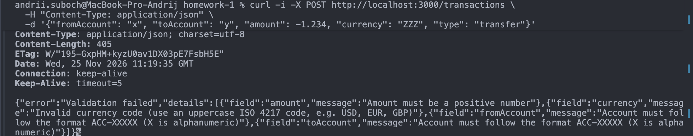

# 🏦 Homework 1: Banking Transactions API

> **Student Name**: [Your Name]
> **Date Submitted**: [Date]
> **AI Tools Used**: Claude Code (Claude Opus 5.5 / Sonnet 5.5)

---

## 📋 Project Overview

A minimal REST API for banking transactions built with **Node.js + Express**, using in-memory storage (no database). Data is lost when the server restarts.

> 🚧 **Work in progress.** Currently implemented: **Task 1 (core API)**, **Task 2 (transaction validation)** and **Task 3 (transaction history filters)**. Still to do: an additional feature (Task 4).

### Endpoints

| Method | Endpoint | Description | Status codes |
|--------|----------|-------------|--------------|
| `POST` | `/transactions` | Create a new transaction | 201, 400 |
| `GET` | `/transactions` | List transactions, optionally filtered (`accountId`, `type`, `from`, `to`) | 200, 400 |
| `GET` | `/transactions/:id` | Get one transaction by ID | 200, 404 |
| `GET` | `/accounts/:accountId/balance` | Get account balance | 200 |
| `GET` | `/health` | Health check | 200 |

Unknown routes return `404`; malformed JSON bodies return `400`; unexpected errors return `500`.

### Project structure

```
src/
├── index.js                          # starts the server (port 3000)
├── app.js                            # Express app, routers, error handlers
├── routes/
│   ├── transactions.js               # /transactions endpoints
│   └── accounts.js                   # /accounts/:accountId/balance
├── models/transaction.js             # in-memory storage + create/find
├── validators/
│   ├── transactionValidator.js       # POST body validation
│   └── filterValidator.js            # GET /transactions query validation
└── utils/
    ├── helpers.js                    # balance calculation + transaction filtering
    └── currencies.js                 # ISO 4217 currency code list
```

---

## 🧠 Design Decisions

| Topic | Decision | Why |
|-------|----------|-----|
| **Storage** | In-memory array | Required by the task; simplest option. |
| **Transaction ID** | UUID (`crypto.randomUUID`) | Unique without a counter or database. |
| **Timestamp** | Set by the server in ISO 8601 | Clients can't forge it. |
| **Status** | Every valid transaction is saved as `completed` | No real processing happens, so `pending`/`failed` are never produced yet. |
| **Required accounts** | `deposit` needs `toAccount`; `withdrawal` needs `fromAccount`; `transfer` needs both and they must differ | Each type involves different accounts. Missing accounts are stored as `null`. |
| **Balance rules** | Only `completed` transactions count. Deposit → `+amount` to `toAccount`; withdrawal → `−amount` from `fromAccount`; transfer → `−amount` from `fromAccount` and `+amount` to `toAccount` | Standard bookkeeping. |
| **Balance per currency** | Response is `{ "accountId": "...", "balances": { "USD": 399.4, "EUR": 20 } }` | USD and EUR can't be added together, so each currency is tracked separately. |
| **Unknown account balance** | `200` with `"balances": {}` | Accounts aren't created explicitly, so an account with no transactions simply has no balance. |
| **Overdraft** | Not checked; a balance can go negative | Not required by the task. |
| **Rounding** | Balances are rounded to 2 decimals | Avoids floating-point drift such as `0.1 + 0.2`. |
| **Validation errors** | All errors collected and returned as `{ "error": "Validation failed", "details": [{ "field", "message" }] }` | Matches the format in `TASKS.md`. |

### Validation rules (Task 2)

All rules run on `POST /transactions`. **Every** problem is collected and returned together, so the client can fix them in one go (`400` + `details` list).

| Field | Rule | Error message |
|-------|------|---------------|
| `amount` | Must be a number greater than 0 (strings like `"10"` are rejected) | `Amount must be a positive number` |
| `amount` | At most 2 decimal places (`100.5` ✅, `100.555` ❌) | `Amount must have at most 2 decimal places` |
| `currency` | Required; must be an **uppercase** ISO 4217 code (~160 active codes: USD, EUR, GBP, JPY, UAH, …) | `Currency is required` / `Invalid currency code (...)` |
| `type` | One of `deposit`, `withdrawal`, `transfer` | `Type must be one of: deposit, withdrawal, transfer` |
| `fromAccount` / `toAccount` | Format `ACC-XXXXX` — `ACC-` plus exactly 5 letters or digits (regex `^ACC-[A-Za-z0-9]{5}$`). Applies to **any** account that is sent, even when optional for the type | `Account must follow the format ACC-XXXXX (X is alphanumeric)` |
| `fromAccount` / `toAccount` | Required depending on type (deposit → `toAccount`; withdrawal → `fromAccount`; transfer → both) | `<field> is required for <type>` |
| `toAccount` | For a transfer it must differ from `fromAccount` | `toAccount must differ from fromAccount` |

Extra decisions:
- Lowercase currency codes (`usd`) and lowercase prefixes (`acc-12345`) are rejected — strict formats are easier to reason about.
- The 2-decimal check compares to the nearest cent with a tiny tolerance, so `0.29` passes (floating point stores it as `0.28999…`) while `1.005` is correctly rejected.
- `GET` endpoints don't validate account IDs; an unknown or malformed ID just returns an empty balance.

### Transaction history filters (Task 3)

`GET /transactions` accepts four optional query parameters. When several are given they are **all applied together (AND)**; with none, every transaction is returned.

| Parameter | Matches | Example |
|-----------|---------|---------|
| `accountId` | Transactions where the account is the sender (`fromAccount`) **or** the receiver (`toAccount`) | `?accountId=ACC-12345` |
| `type` | Exact type: `deposit`, `withdrawal` or `transfer` | `?type=transfer` |
| `from` | Transactions at or after this moment | `?from=2024-01-01` |
| `to` | Transactions at or before this moment | `?to=2024-01-31` |

Decisions:
- **Dates:** `from`/`to` accept `YYYY-MM-DD` or a full ISO 8601 datetime with timezone (`2024-01-31T10:00:00Z`). All dates are interpreted in **UTC**.
- **Inclusive range:** a date-only `from` means the start of that day (`00:00:00.000`) and a date-only `to` means the **end** of that day (`23:59:59.999`), so `from=2024-01-31&to=2024-01-31` returns the whole day.
- **Strict input:** invalid values return `400` with the same `{"error": "Validation failed", "details": [...]}` format instead of being silently ignored. That covers a bad account format, an unknown type, a non-date (`from=yesterday`), an impossible date (`2024-02-30`), `from` later than `to`, and a repeated parameter (`?type=a&type=b`). All problems are reported together.
- **No match** is not an error: it returns `200` with `[]`.

---

## 🧪 Example Requests

Start the server first (`npm start`), then run these in a second terminal. The server runs at `http://localhost:3000`.

### 1. Create a transaction — `POST /transactions`

**Deposit** (needs `toAccount`):
```bash
curl -X POST http://localhost:3000/transactions \
  -H "Content-Type: application/json" \
  -d '{
    "toAccount": "ACC-12345",
    "amount": 500,
    "currency": "USD",
    "type": "deposit"
  }'
```

**Transfer** (needs `fromAccount` and `toAccount`):
```bash
curl -X POST http://localhost:3000/transactions \
  -H "Content-Type: application/json" \
  -d '{
    "fromAccount": "ACC-12345",
    "toAccount": "ACC-67890",
    "amount": 100.50,
    "currency": "USD",
    "type": "transfer"
  }'
```

**Withdrawal** (needs `fromAccount`):
```bash
curl -X POST http://localhost:3000/transactions \
  -H "Content-Type: application/json" \
  -d '{
    "fromAccount": "ACC-12345",
    "amount": 50,
    "currency": "USD",
    "type": "withdrawal"
  }'
```

Response — `201 Created`:
```json
{
  "id": "7d08143f-0bc6-483f-971d-7aecf717087b",
  "fromAccount": "ACC-12345",
  "toAccount": "ACC-67890",
  "amount": 100.5,
  "currency": "USD",
  "type": "transfer",
  "timestamp": "2026-11-25T10:23:55.736Z",
  "status": "completed"
}
```

### 2. List all transactions — `GET /transactions`

```bash
curl http://localhost:3000/transactions
```
Response — `200 OK`: an array of transactions (empty array `[]` if none yet).

### 3. Get one transaction — `GET /transactions/:id`

Replace `<id>` with an `id` from a previous response:
```bash
curl http://localhost:3000/transactions/<id>
```
Response — `200 OK` with the transaction, or `404`:
```json
{ "error": "Transaction not found" }
```

Not-found example:
```bash
curl -i http://localhost:3000/transactions/does-not-exist
```

### 4. Get account balance — `GET /accounts/:accountId/balance`

```bash
curl http://localhost:3000/accounts/ACC-12345/balance
```
Response — `200 OK` (after the deposit, transfer and withdrawal above):
```json
{
  "accountId": "ACC-12345",
  "balances": { "USD": 349.5 }
}
```

### 5. Filter the history — `GET /transactions?...` (Task 3)

Assuming these transactions exist (created with the examples above): a 500 USD deposit to `ACC-12345`, a 100.50 USD transfer `ACC-12345 → ACC-67890`, and a 50 USD withdrawal from `ACC-12345`.

**By account** (sender or receiver) — returns all three above for `ACC-12345`, only the transfer for `ACC-67890`:
```bash
curl "http://localhost:3000/transactions?accountId=ACC-12345"
curl "http://localhost:3000/transactions?accountId=ACC-67890"
```

**By type:**
```bash
curl "http://localhost:3000/transactions?type=transfer"
```

**By date range** (inclusive, whole days in UTC):
```bash
curl "http://localhost:3000/transactions?from=2024-01-01&to=2024-01-31"

# only one boundary
curl "http://localhost:3000/transactions?from=2024-01-01"
curl "http://localhost:3000/transactions?to=2024-01-31"

# a single day
curl "http://localhost:3000/transactions?from=2024-01-15&to=2024-01-15"

# exact time with an ISO 8601 datetime
curl "http://localhost:3000/transactions?from=2024-01-15T09:00:00Z&to=2024-01-15T17:30:00Z"
```

**Combine filters** — transfers of `ACC-12345` during January 2024:
```bash
curl "http://localhost:3000/transactions?accountId=ACC-12345&type=transfer&from=2024-01-01&to=2024-01-31"
```

**Today's transactions** (handy for a quick demo, because timestamps are set by the server):
```bash
curl "http://localhost:3000/transactions?from=$(date -u +%F)&to=$(date -u +%F)"
```

**No matches** → `200 []`:
```bash
curl "http://localhost:3000/transactions?accountId=ACC-99999"
```

### 6. Validation error examples (Task 2)

All of these return `400` with `{"error": "Validation failed", "details": [...]}`.

**Too many decimal places:**
```bash
curl -i -X POST http://localhost:3000/transactions \
  -H "Content-Type: application/json" \
  -d '{"toAccount": "ACC-12345", "amount": 100.555, "currency": "USD", "type": "deposit"}'
```
```json
{
  "error": "Validation failed",
  "details": [
    { "field": "amount", "message": "Amount must have at most 2 decimal places" }
  ]
}
```

**Zero, negative or non-numeric amount:**
```bash
curl -i -X POST http://localhost:3000/transactions \
  -H "Content-Type: application/json" \
  -d '{"toAccount": "ACC-12345", "amount": -5, "currency": "USD", "type": "deposit"}'

curl -i -X POST http://localhost:3000/transactions \
  -H "Content-Type: application/json" \
  -d '{"toAccount": "ACC-12345", "amount": "abc", "currency": "USD", "type": "deposit"}'
```
→ `{"field": "amount", "message": "Amount must be a positive number"}`

**Invalid account format** (too short, too long, wrong prefix or special characters):
```bash
curl -i -X POST http://localhost:3000/transactions \
  -H "Content-Type: application/json" \
  -d '{"toAccount": "ACC-123", "amount": 10, "currency": "USD", "type": "deposit"}'
```
```json
{
  "error": "Validation failed",
  "details": [
    { "field": "toAccount", "message": "Account must follow the format ACC-XXXXX (X is alphanumeric)" }
  ]
}
```
Other rejected examples: `ACC-123456`, `ACC-12#45`, `acc-12345`, `12345`. Accepted: `ACC-12345`, `ACC-AB12Z`.

**Invalid currency code:**
```bash
curl -i -X POST http://localhost:3000/transactions \
  -H "Content-Type: application/json" \
  -d '{"toAccount": "ACC-12345", "amount": 10, "currency": "XXX", "type": "deposit"}'
```
→ `{"field": "currency", "message": "Invalid currency code (use an uppercase ISO 4217 code, e.g. USD, EUR, GBP)"}`

Also rejected: `"usd"` (lowercase), `"DOLLAR"`, `123`. Accepted: `"JPY"`, `"UAH"`, `"PLN"`.

**Transfer to the same account:**
```bash
curl -i -X POST http://localhost:3000/transactions \
  -H "Content-Type: application/json" \
  -d '{"fromAccount": "ACC-12345", "toAccount": "ACC-12345", "amount": 10, "currency": "USD", "type": "transfer"}'
```
→ `{"field": "toAccount", "message": "toAccount must differ from fromAccount"}`

**Transfer missing `fromAccount`:**
```bash
curl -i -X POST http://localhost:3000/transactions \
  -H "Content-Type: application/json" \
  -d '{"toAccount": "ACC-12345", "amount": 5, "currency": "USD", "type": "transfer"}'
```
→ `{"field": "fromAccount", "message": "fromAccount is required for transfer"}`

**Everything wrong at once** — all errors are reported together:
```bash
curl -i -X POST http://localhost:3000/transactions \
  -H "Content-Type: application/json" \
  -d '{"fromAccount": "x", "toAccount": "y", "amount": -1.234, "currency": "ZZZ", "type": "transfer"}'
```
```json
{
  "error": "Validation failed",
  "details": [
    { "field": "amount", "message": "Amount must be a positive number" },
    { "field": "currency", "message": "Invalid currency code (use an uppercase ISO 4217 code, e.g. USD, EUR, GBP)" },
    { "field": "fromAccount", "message": "Account must follow the format ACC-XXXXX (X is alphanumeric)" },
    { "field": "toAccount", "message": "Account must follow the format ACC-XXXXX (X is alphanumeric)" }
  ]
}
```

📸 Real output from the running API:



### 7. Invalid filters (Task 3)

All return `400`. Invalid type:
```bash
curl -i "http://localhost:3000/transactions?type=gift"
```
```json
{
  "error": "Validation failed",
  "details": [
    { "field": "type", "message": "type must be one of: deposit, withdrawal, transfer" }
  ]
}
```

Other rejected requests:
```bash
curl -i "http://localhost:3000/transactions?accountId=12345"            # not ACC-XXXXX
curl -i "http://localhost:3000/transactions?from=yesterday"             # not a date
curl -i "http://localhost:3000/transactions?to=2024-02-30"              # impossible date
curl -i "http://localhost:3000/transactions?from=2024-02-01&to=2024-01-01"  # from after to
curl -i "http://localhost:3000/transactions?type=deposit&type=transfer" # repeated parameter
```
→ e.g. `{"field": "from", "message": "from must not be later than to"}`

**Several invalid filters at once** — all errors are reported together:
```bash
curl -i "http://localhost:3000/transactions?accountId=bad&type=gift&from=x"
```

### 8. Other errors

**Malformed JSON** → `400 {"error": "Invalid JSON body"}`:
```bash
curl -i -X POST http://localhost:3000/transactions \
  -H "Content-Type: application/json" \
  -d '{bad json'
```

**Unknown route** → `404 {"error": "Not found"}`:
```bash
curl -i http://localhost:3000/nope
```

---

<div align="center">

*This project was completed as part of the AI-Assisted Development course.*

</div>
